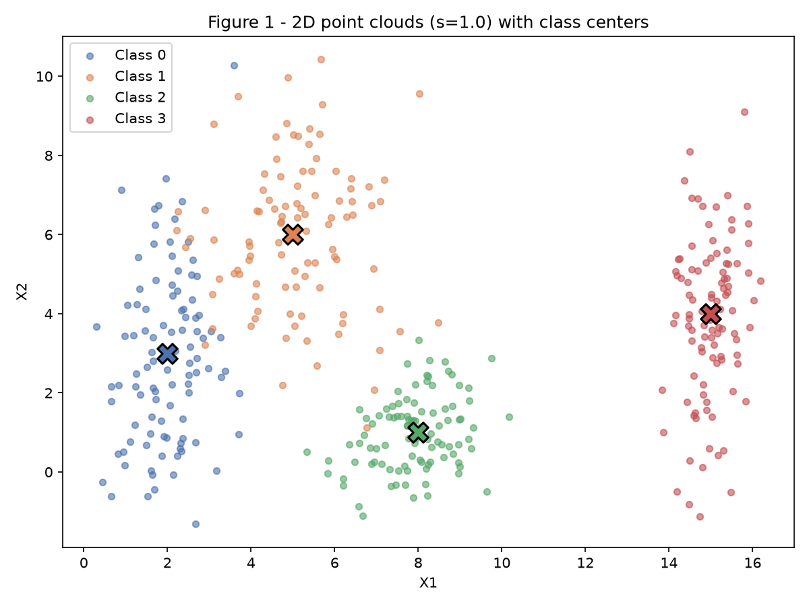
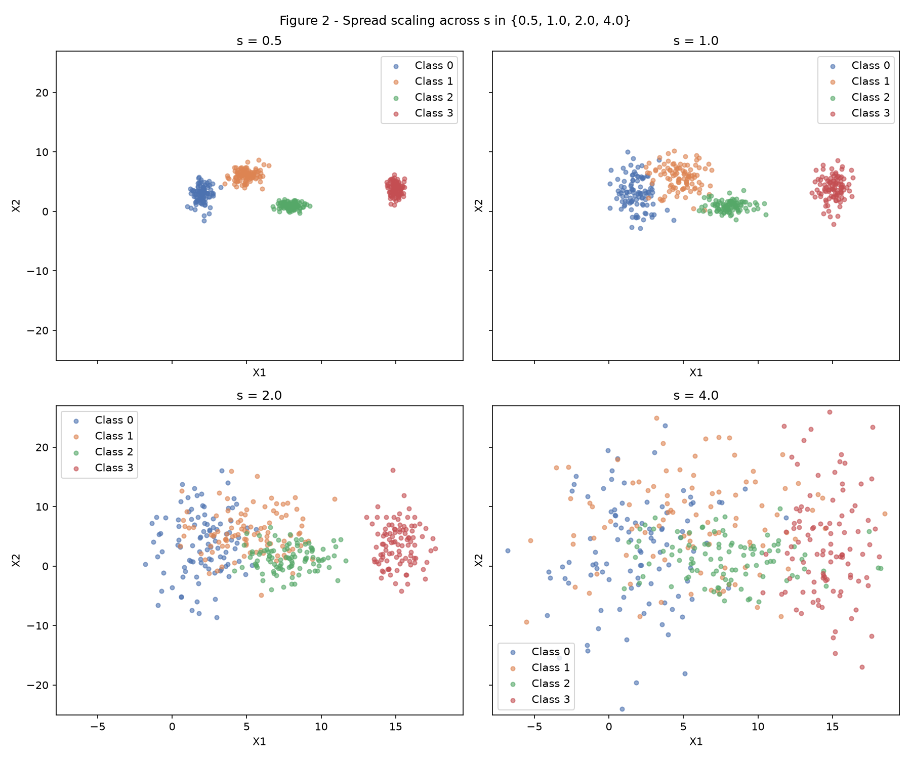
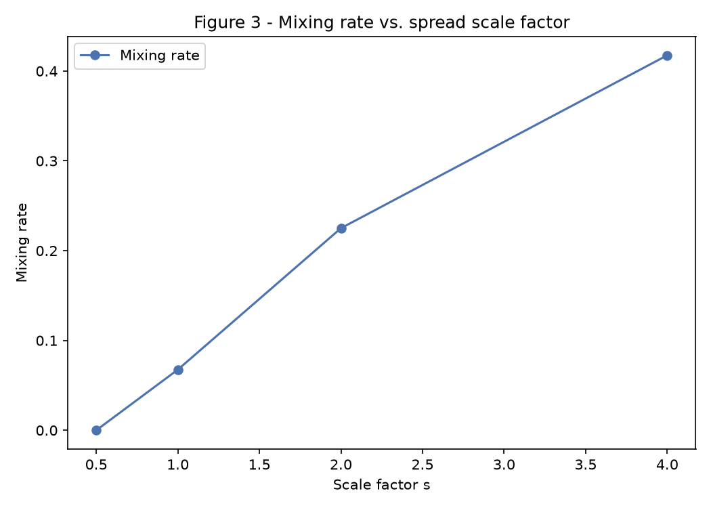
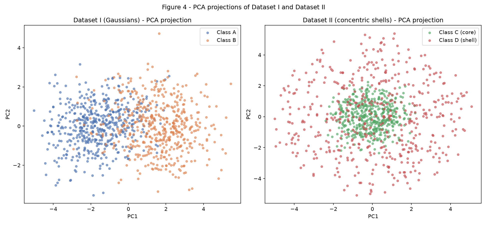
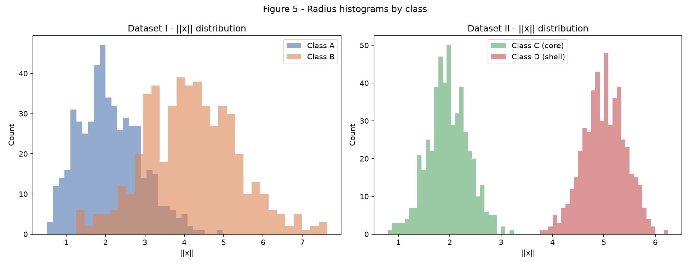
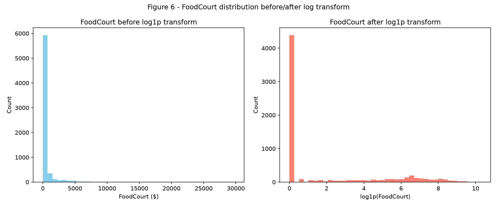

# Exercise 1 — Data

All code below is fixed with `rng = np.random.default_rng(42)` and reads/writes only inside this exercise's `code/` and `figures/` folders. Run any script from a clean checkout with:

``` shell
python3 -m venv env
source ./env/bin/activate
python3 -m pip install -r requirements.txt --upgrade
python3 docs/exercises/data/code/ex1_point_clouds.py
python3 docs/exercises/data/code/ex2_nonlinearity.py
python3 docs/exercises/data/code/ex3_spaceship_titanic.py
```

## Exercise 1 — Point Clouds

### A — Generate and plot

Four Gaussian classes (100 points each) were sampled with `Class 0: μ=[2,3], σ=[0.8,2.5]`, `Class 1: μ=[5,6], σ=[1.2,1.9]`, `Class 2: μ=[8,1], σ=[0.9,0.9]`, `Class 3: μ=[15,4], σ=[0.5,2.0]`.

``` python
--8<-- "docs/exercises/data/code/ex1_point_clouds.py"
```



### B — Spread study

Each class's standard deviation was scaled by `s ∈ {0.5, 1.0, 2.0, 4.0}` while the means stayed fixed.



**Separation ratios** r_ij = ‖μᵢ−μⱼ‖ / (σ̄ᵢ+σ̄ⱼ) at s=1.0:

| Pair | r_ij |
|---|---|
| (0, 1) | 1.3258 |
| (1, 2) | 2.3800 |
| (0, 2) | 2.4802 |
| (2, 3) | 3.5422 |
| (1, 3) | 3.6422 |
| (0, 3) | 4.4960 |

At s=2.0, every r_ij is exactly halved (only σ scales with s, μ is fixed, so r_ij(s) = r_ij(1)/s): smallest pair (0, 1) drops from 1.3258 to **0.6629**.

**Mixing rate** (fraction of points closer to a foreign class center than their own) at each scale:

| s | Mixing rate |
|---|---|
| 0.5 | 0.0000 |
| 1.0 | 0.0675 |
| 2.0 | 0.2250 |
| 4.0 | 0.4175 |



### C — Analysis

At s=1.0, classes 0 and 1 overlap the most (r_ij = 1.33, the smallest pair) since their means are only [3, 3] apart while both classes carry standard deviations above 1 on the y-axis; classes 2 and 3 barely touch. Class 0 vs 1 is the pair driving essentially all of the mixing rate at s=1.0 (6.75%).

Linear separability of **all four** classes survives up to s≈1.0 only in the sense that classes 2 and 3 stay clean; classes 0 and 1 already need a non-trivial (non-axis-aligned) boundary at s=1.0. By s=2.0, r_ij for (0,1) drops below 1 and mixing rate jumps to 22.5% — this is the point where a single global linear boundary can no longer separate all four classes without misclassifying a meaningful fraction of points. By s=4.0, three of the six pairs have r_ij below 2 and mixing rate reaches 41.75%, i.e. classes are close to indistinguishable by proximity to their generating centers. A decision boundary sketched on Figure 1 would need to be a near-vertical line separating class 3 (X1≈15) from the rest, plus a diagonal line splitting the class-0/class-1 cluster — consistent with r_ij ranking (0,3) as most separated and (0,1) as least.

## Exercise 2 — Non-Linearity in 5D

### A — Dataset I (Gaussians)

Two 500-point multivariate Gaussians in ℝ⁵ with the specified mean vectors and covariance matrices.

``` python
--8<-- "docs/exercises/data/code/ex2_nonlinearity.py"
```

### B — Dataset II (concentric shells)

For each point, a direction `u` was drawn uniformly on the unit sphere in ℝ⁵ (`v ~ N(0, I₅)`, `u = v/‖v‖`), then scaled by a class-specific radius: core class C has `ρ ~ N(2.0, 0.4)`, shell class D has `ρ ~ N(5.0, 0.4)`, giving `x = ρ·u`.

### C — PCA and geometric measures



| Metric | Dataset I | Dataset II |
|---|---|---|
| Explained variance (PC1+PC2) | 0.6704 | 0.4291 |
| 5D distance between class centers | 3.2643 | 0.2662 |



### D — Analysis

Dataset I's PCA projection keeps the two classes visibly apart because their means are genuinely 3.26 units apart in ℝ⁵, and 67% of the variance already lives in the top two components — a linear model separates them easily on this projection.

Dataset II is the opposite case: class C and D centers sit only 0.27 units apart in ℝ⁵ — effectively coincident, since directions are drawn uniformly on the sphere and average out to the origin for both classes. No hyperplane can separate two classes whose means coincide, because a hyperplane's decision only depends on which side of an affine boundary a point's *mean-relative* position falls on, and both classes are centered at the same point in every direction. What actually separates them is the **radius**, ‖x‖, which Figure 5 shows as two cleanly separated histograms (core around 2.0, shell around 5.0) — information a linear projection (PCA or a hyperplane) discards because it operates on direction, not magnitude. This is exactly why the 2D PCA scatter for Dataset II looks like two overlapping blobs even though the classes are perfectly separable: PCA is still a linear technique, and linear techniques cannot "see" the radial structure. The natural separating function is the squared norm, `‖x‖² = Σᵢ xᵢ²`, thresholded at some value between the two radius populations (e.g. ‖x‖² ≈ 10.6, roughly the midpoint between 2.0² and 5.0²) — a quadratic function of the inputs, which is exactly the kind of non-linear boundary a multi-layer network with non-linear activations can learn but a Perceptron cannot.

## Exercise 3 — Spaceship Titanic

### A — Data description

The target `Transported` indicates whether a passenger was pulled into an alternate dimension during the collision; it is close to balanced: **50.36% True / 49.64% False**.

- **Numerical features:** `Age, RoomService, FoodCourt, ShoppingMall, Spa, VRDeck`
- **Categorical features:** `HomePlanet, CryoSleep, Cabin, Destination, VIP` (plus the free-text `Name`/`PassengerId`, dropped in preprocessing)

**Missing values** (all columns have some, none catastrophic — roughly 2–2.5% each):

| Column | Missing | % |
|---|---|---|
| CryoSleep | 217 | 2.50 |
| ShoppingMall | 208 | 2.39 |
| VIP | 203 | 2.34 |
| HomePlanet | 201 | 2.31 |
| Name | 200 | 2.30 |
| Cabin | 199 | 2.29 |
| VRDeck | 188 | 2.16 |
| FoodCourt | 183 | 2.11 |
| Spa | 183 | 2.11 |
| Destination | 182 | 2.09 |
| RoomService | 181 | 2.08 |
| Age | 179 | 2.06 |

**Spending columns** — mean far exceeds median for all five, confirming heavy right skew (most passengers spend 0, a minority spends thousands):

| Column | Mean | Median | Max |
|---|---|---|---|
| RoomService | 224.69 | 0.0 | 14,327 |
| FoodCourt | 458.08 | 0.0 | 29,813 |
| ShoppingMall | 173.73 | 0.0 | 23,492 |
| Spa | 311.14 | 0.0 | 22,408 |
| VRDeck | 304.85 | 0.0 | 24,133 |

### B — Split strategy

The data was split 80/20, **stratified on `Transported`**, with `random_state=42`, **before** any imputation, encoding, or scaling: train shape (6954, 14), test shape (1739, 14), and both keep the ~50.4/49.6 target balance.

``` python
--8<-- "docs/exercises/data/code/ex3_spaceship_titanic.py"
```

Fitting an imputer, scaler, or encoder on the full dataset before splitting lets statistics from test rows (the median used to fill a NaN, the mean/std used to scale, the set of categories seen by the one-hot encoder) leak into what the model implicitly learns from, making the held-out test performance an overly optimistic estimate of generalization. Splitting first and fitting every transformer only on the training fold — then just `.transform()`-ing the test fold — keeps the test set a genuinely unseen sample.

### C — Preprocessing

- **Feature engineering:** `TotalSpend = RoomService + FoodCourt + ShoppingMall + Spa + VRDeck` (row-wise sum, NaNs treated as 0 spend); `PassengerId`, `Name`, and `Cabin` dropped (`Cabin`'s deck/num/side would need its own encoding and isn't required by the assignment).
- **Log transform:** `log1p(x)` applied to the five spending columns and `TotalSpend`, before scaling — with so many zeros and a few extreme outliers (max 29,813 vs. median 0), a raw z-score would be dominated by outliers; `log1p` compresses the tail while leaving zeros at zero.
- **Imputation:** numerical columns (`Age` + spend + `TotalSpend`) filled with the **train median**; categorical columns (`HomePlanet, CryoSleep, Destination, VIP`) filled with the **train mode** — both are the standard low-bias default for ~2% missingness and, being fit only on train, avoid leakage.
- **Encoding:** `OneHotEncoder(handle_unknown="ignore")` on the four categoricals — `handle_unknown="ignore"` means a category present only in test (never seen in train) is encoded as all-zeros instead of raising an error.
- **Scaling:** `StandardScaler` (mean 0, std 1) on the numerical block, fit on train only. Standardization was chosen over min-max-to-`[-1,1]` because the spending features (even after `log1p`) still have a long tail and standardization doesn't collapse the bulk of the distribution into a tiny sub-interval the way min-max scaling would under a few extreme points.

Final feature matrix: **(6954, 17)** on train, **(1739, 17)** on test. Scaled numeric range: train `[-1.9961, 3.5080]`, test `[-1.9961, 3.3687]` — not bounded to exactly `[-1, 1]` (standardization doesn't guarantee that), but the vast majority of values sit within 2 standard deviations, which is a stable input range for a `tanh` hidden layer.

### D — Verification and visualization



- **No NaNs remaining** in the final training matrix (verified: 0).
- **Final shape:** (6954, 17) train / (1739, 17) test — 17 = 7 numeric (`Age`, 5 spend columns, `TotalSpend`) + 10 one-hot categorical columns (`HomePlanet`:3, `CryoSleep`:2, `Destination`:3, `VIP`:2).
- **Range check:** scaled numeric values fall within roughly ±3.5, compatible with feeding a `tanh` hidden layer without saturating the vast majority of activations.

**Reflection:** the single decision with the largest downstream impact is the **log transform on spending**. Without it, `StandardScaler` would center and scale around a distribution where 50%+ of values are exactly 0 and a handful are in the tens of thousands — the resulting z-scores would push almost all real spenders into a narrow high-magnitude tail, saturating `tanh` for most non-zero spenders and giving the network almost no useful gradient to distinguish "spent a little" from "spent a lot." Log-compressing first turns that into a roughly usable range before scaling ever sees it.

## Results summary

| # | Item | Value |
|---|---|---|
| 1 | Mixing rate at s=0.5 | 0.0000 |
| 2 | Mixing rate at s=1.0 | 0.0675 |
| 3 | Mixing rate at s=2.0 | 0.2250 |
| 4 | Mixing rate at s=4.0 | 0.4175 |
| 5 | Smallest r_ij at s=1.0 & pair | 1.3258 (classes 0, 1) |
| 6 | Distance between centers — Dataset I | 3.2643 |
| 7 | Distance between centers — Dataset II | 0.2662 |
| 8 | Explained variance PC1+PC2 — Dataset I | 0.6704 |
| 9 | Explained variance PC1+PC2 — Dataset II | 0.4291 |
| 10 | Share of positive class in Transported | 0.5036 |
| 11 | Mean & median FoodCourt (training, pre-transform) | 458.08 / 0.0 |
| 12 | Final shape of training feature matrix | (6954, 17) |
| 13 | Min/max after scaling (train & test) | train [-1.9961, 3.5080] / test [-1.9961, 3.3687] |
