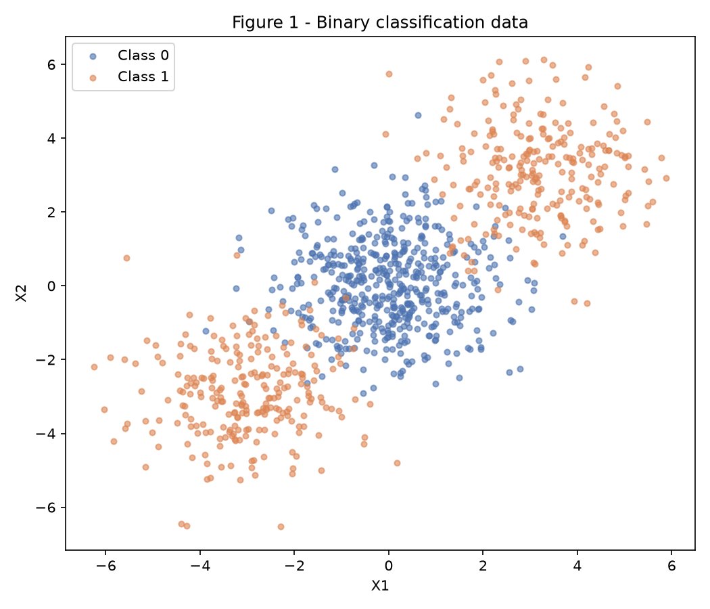
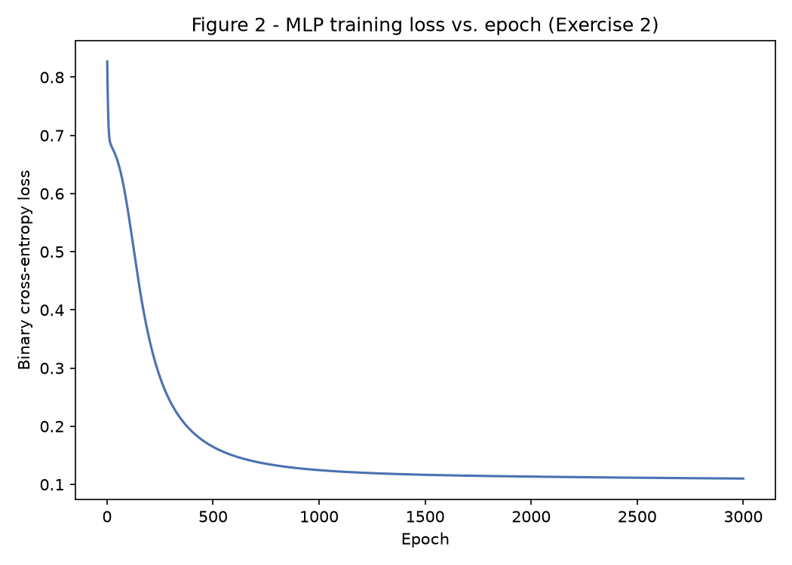
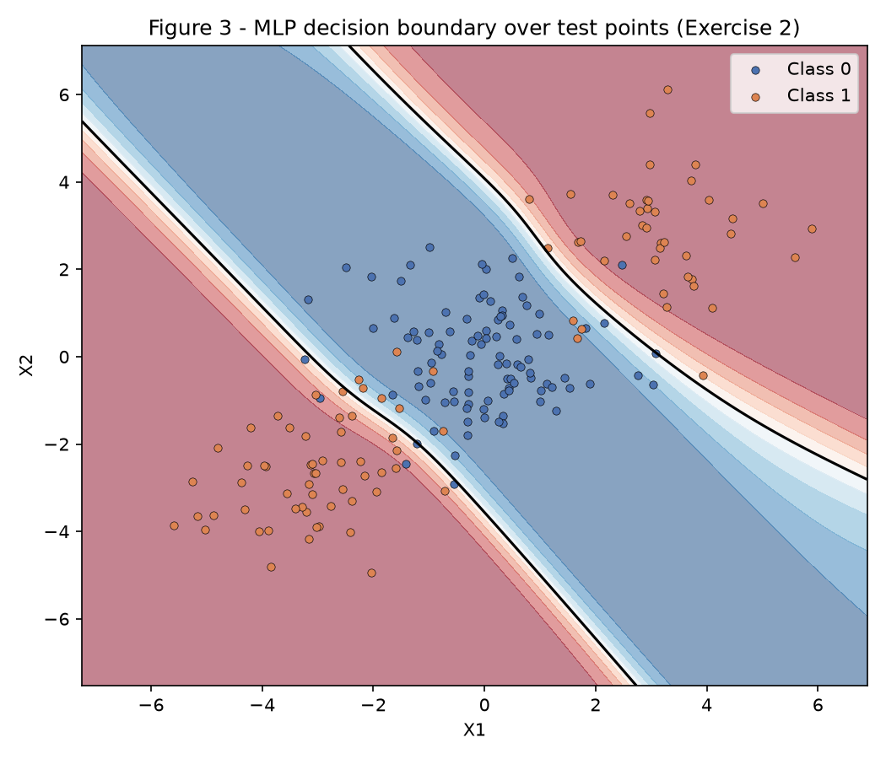
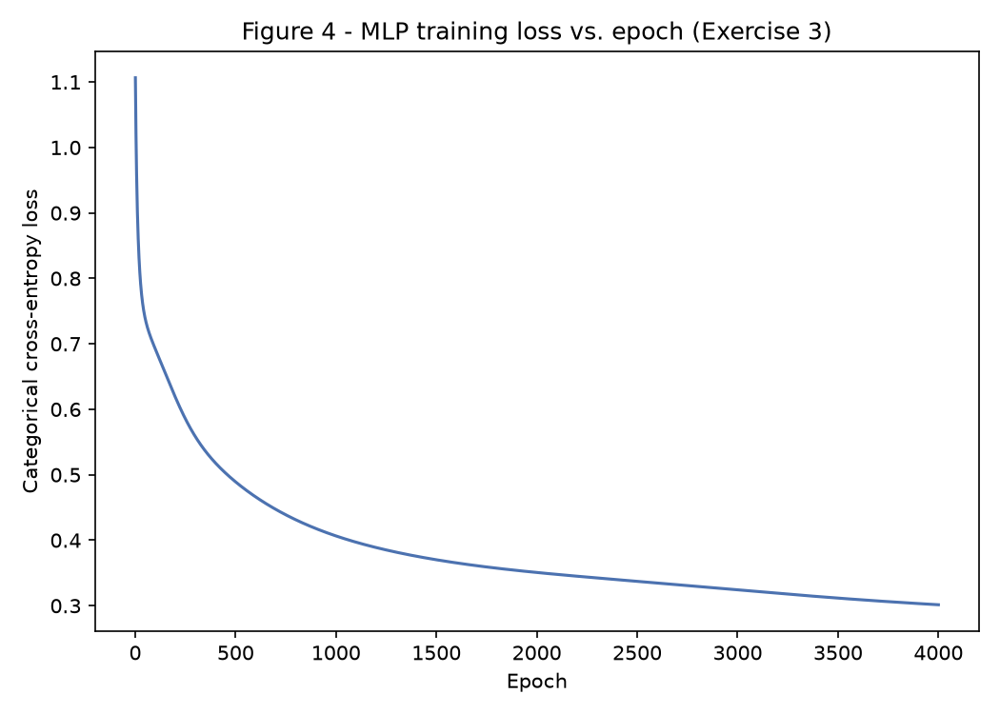
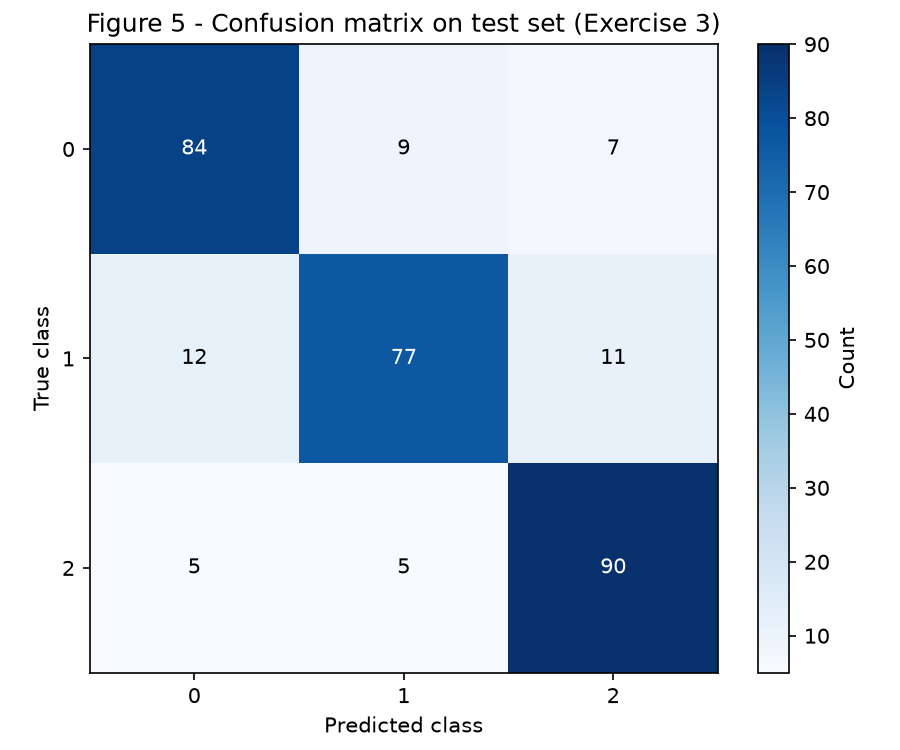
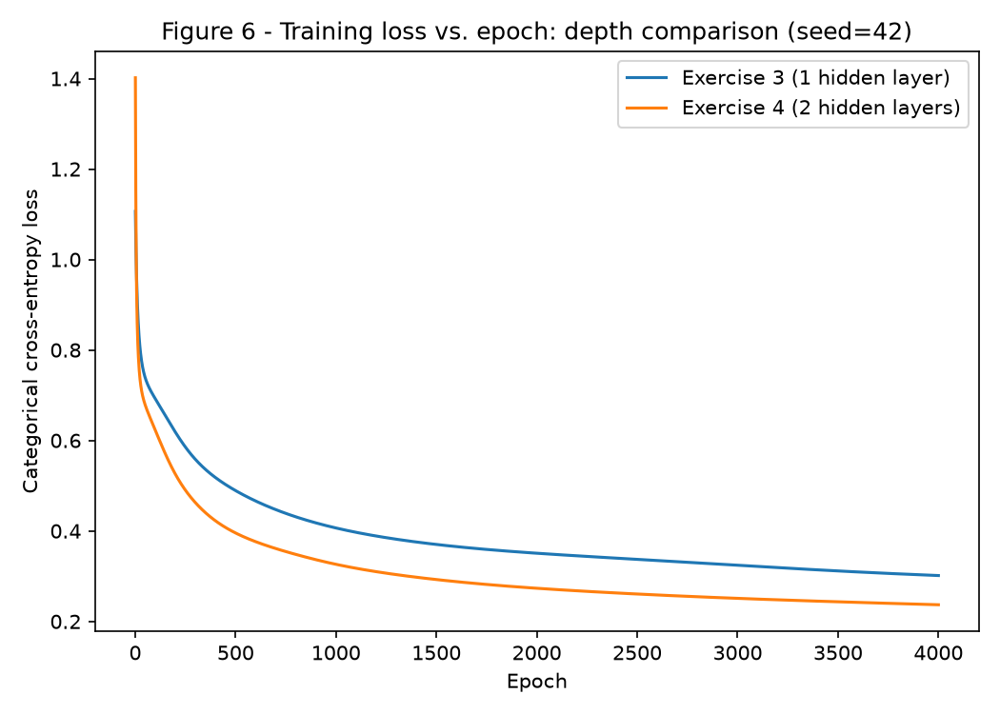

# Exercise 3 — MLP

A single `MLP` class (`code/mlp.py`) implements forward pass, loss, backward pass and parameter update from scratch (numpy only) and is reused, unmodified, across Exercises 2, 3 and 4 — only the output head (`sigmoid` vs. `softmax`) and the layer sizes change. Everything is fixed with `rng = np.random.default_rng(42)` (dataset generation always uses `random_state=42`; weight-init seeds are called out explicitly where they vary, in Exercise 4). Run any script from a clean checkout with:

``` shell
python3 -m venv env
source ./env/bin/activate
python3 -m pip install -r requirements.txt --upgrade
python3 docs/exercises/mlp/code/ex1_backprop.py
python3 docs/exercises/mlp/code/ex2_binary.py
python3 docs/exercises/mlp/code/ex3_multiclass.py
python3 docs/exercises/mlp/code/ex4_depth.py
```

### Shared MLP implementation

Hidden layers use `tanh`; the output head is either `sigmoid` (binary cross-entropy) or `softmax` (categorical cross-entropy). For both heads the output-layer error signal reduces to the same expression, `delta_L = (a_L - y) / N` — derived by hand in Exercise 3.B — so one `backward()` implementation serves every exercise below.

``` python
--8<-- "docs/exercises/mlp/code/mlp.py"
```

## Exercise 1 — One Step of Backpropagation by Hand

Network: 2 inputs → 2 hidden units (`tanh`) → 1 output (`tanh`), loss \(L=(y-\hat y)^2\) for a single sample `x = [0.5, -0.2]`, `y = 1.0`, with `W⁽¹⁾=[[0.3,-0.1],[0.2,0.4]]`, `b⁽¹⁾=[0.1,-0.2]`, `W⁽²⁾=[0.5,-0.3]`, `b⁽²⁾=0.2`, `η=0.3`. The arithmetic below was carried out by hand and cross-checked against `code/ex1_backprop.py`.

``` python
--8<-- "docs/exercises/mlp/code/ex1_backprop.py"
```

### A — Forward pass

\[
\mathbf{z}^{(1)} = \mathbf{W}^{(1)}\mathbf{x}+\mathbf{b}^{(1)} = [0.3(0.5)+(-0.1)(-0.2)+0.1,\ \ 0.2(0.5)+0.4(-0.2)-0.2] = [0.2700,\ -0.1800]
\]

\[
\mathbf{h}^{(1)} = \tanh(\mathbf{z}^{(1)}) = [0.2636,\ -0.1781]
\]

\[
u^{(2)} = \mathbf{W}^{(2)}\cdot\mathbf{h}^{(1)}+b^{(2)} = 0.5(0.2636)-0.3(-0.1781)+0.2 = 0.3852
\]

\[
\hat y = \tanh(u^{(2)}) = 0.3672, \qquad L=(y-\hat y)^2 = (1-0.3672)^2 = 0.4004
\]

### B — Backward pass

Starting from \(\partial L/\partial \hat y\) and chaining outward, using \(\frac{d}{du}\tanh(u)=1-\tanh^2(u)\):

\[
\frac{\partial L}{\partial \hat y} = -2(y-\hat y) = -1.2655, \qquad
\frac{\partial \hat y}{\partial u^{(2)}} = 1-\hat y^2 = 0.8651
\]

\[
\frac{\partial L}{\partial u^{(2)}} = \frac{\partial L}{\partial \hat y}\cdot\frac{\partial \hat y}{\partial u^{(2)}} = -1.0948
\]

**Output layer:**

\[
\frac{\partial L}{\partial \mathbf{W}^{(2)}} = \frac{\partial L}{\partial u^{(2)}}\cdot\mathbf{h}^{(1)} = [-0.2886,\ 0.1950], \qquad
\frac{\partial L}{\partial b^{(2)}} = \frac{\partial L}{\partial u^{(2)}} = -1.0948
\]

**Propagate to the hidden layer:**

\[
\frac{\partial L}{\partial \mathbf{h}^{(1)}} = \frac{\partial L}{\partial u^{(2)}}\cdot\mathbf{W}^{(2)} = [-0.5474,\ 0.3284], \qquad
\frac{\partial \mathbf{h}^{(1)}}{\partial \mathbf{z}^{(1)}} = 1-(\mathbf{h}^{(1)})^2 = [0.9305,\ 0.9683]
\]

\[
\frac{\partial L}{\partial \mathbf{z}^{(1)}} = \frac{\partial L}{\partial \mathbf{h}^{(1)}}\odot\frac{\partial \mathbf{h}^{(1)}}{\partial \mathbf{z}^{(1)}} = [-0.5094,\ 0.3180]
\]

**Hidden layer:**

\[
\frac{\partial L}{\partial \mathbf{W}^{(1)}} = \frac{\partial L}{\partial \mathbf{z}^{(1)}}\otimes\mathbf{x} =
\begin{bmatrix}-0.2547 & 0.1019\\ 0.1590 & -0.0636\end{bmatrix}, \qquad
\frac{\partial L}{\partial \mathbf{b}^{(1)}} = \frac{\partial L}{\partial \mathbf{z}^{(1)}} = [-0.5094,\ 0.3180]
\]

### C — Parameter update

Applying \(\theta \leftarrow \theta - \eta\,\partial L/\partial \theta\) with \(\eta=0.3\) to all eight parameters:

| Parameter | Old | New |
|---|---|---|
| \(W^{(1)}_{11}, W^{(1)}_{12}\) | 0.3000, -0.1000 | 0.3764, -0.1306 |
| \(W^{(1)}_{21}, W^{(1)}_{22}\) | 0.2000, 0.4000 | 0.1523, 0.4191 |
| \(b^{(1)}_1, b^{(1)}_2\) | 0.1000, -0.2000 | 0.2528, -0.2954 |
| \(W^{(2)}_1, W^{(2)}_2\) | 0.5000, -0.3000 | 0.5866, -0.3585 |
| \(b^{(2)}\) | 0.2000 | 0.5284 |

Re-running the forward pass with the updated parameters gives \(\hat y_{\text{new}}=0.7112\) and \(L_{\text{new}}=0.0834\) — down from \(L=0.4004\), confirming the update step reduced the loss, as a single gradient-descent step on a convex-in-its-own-gradient-direction loss is guaranteed to do for a small enough \(\eta\).

## Exercise 2 — Binary Classification

### A — Data

1000 points from `make_blobs` with `centers=[[0,0],[3,3],[-3,-3]]`, `n_samples=[500,250,250]`, `cluster_std=1.2`; the single `[0,0]` cluster is Class 0 (500 pts), the two outer clusters are merged into Class 1 (250+250 pts). 80/20 stratified split, `random_state=42`.



### B — Linear baseline

`LogisticRegression` test accuracy: **0.4750**.

### C — From-scratch MLP

Architecture `[2, 8, 1]` (one hidden layer, 8 `tanh` units, `sigmoid` output), `η=0.1`, 3000 epochs, full-batch gradient descent.

``` python
--8<-- "docs/exercises/mlp/code/ex2_binary.py"
```

| Quantity | Value |
|---|---|
| Final training loss (BCE) | 0.1101 |
| Test accuracy | **0.9200** |





### D — Analysis

The logistic-regression baseline (47.50%) scores *below* chance because of how the data was built: Class 1 is two clusters placed symmetrically on opposite sides of the origin (`[3,3]` and `[-3,-3]`), so Class 1's own centroid averages out to `[0,0]` — exactly Class 0's centroid. A linear classifier's decision direction is driven by the difference between class means; when that difference is ~zero, logistic regression has essentially no linear signal to exploit and the line it converges to (shaped only by the comparatively small asymmetries in the finite sample) performs at or below chance.

Figure 3 shows exactly why no single straight line can do better: the MLP assigns Class 1 to two disjoint diagonal wedges in the top-right and bottom-left, with Class 0 occupying the diagonal corridor *between* them. A straight line always cuts the plane into exactly two half-planes, so it can place at most one of the two Class-1 wedges on the correct side — not both at once, since they sit on opposite sides of Class 0. The MLP's 8 hidden `tanh` units each contribute one linear cut of the input space; the output layer then recombines those cuts into a non-convex union (a corridor flanked by two separate regions), which is exactly the shape in Figure 3 and is structurally impossible for any single hyperplane to reproduce.

## Exercise 3 — Multi-Class Classification

### A — Data

`make_classification(n_samples=1500, n_features=4, n_informative=4, n_redundant=0, n_repeated=0, n_classes=3, n_clusters_per_class=2, class_sep=1.0, random_state=42)` — 3 classes, each made of 2 clusters in ℝ⁴ (6 clusters total). 80/20 stratified split, `random_state=42`.

### B — Softmax + categorical cross-entropy derivation

With \(p=\mathrm{softmax}(u)\) and one-hot target \(y\), the categorical cross-entropy is \(L=-\sum_k y_k\log p_k\). For any output unit \(j\):

\[
\frac{\partial L}{\partial u_j} = \sum_k \frac{\partial L}{\partial p_k}\frac{\partial p_k}{\partial u_j}
= \sum_k \left(-\frac{y_k}{p_k}\right)p_k(\mathbb{1}[k=j]-p_j)
= -y_j(1-p_j) + \sum_{k\neq j} y_k\, p_j
= p_j\sum_k y_k - y_j = p_j - y_j
\]

(using \(\sum_k y_k=1\) since \(y\) is one-hot, and the softmax Jacobian \(\partial p_k/\partial u_j = p_k(\mathbb{1}[k=j]-p_j)\)). So \(\partial L/\partial \mathbf{u} = \mathbf{p}-\mathbf{y}\) — identical in form to the sigmoid+binary-cross-entropy gradient \(\partial L/\partial u = p - y\) derived implicitly in Exercise 2. This is why `MLP.backward()` needs no branch for the output layer: `delta = (a[-1] - y_target) / N` is the correct output delta for *either* head, and only the hidden-layer `tanh` backprop (shared code) runs after it — fulfilling the extra-credit "reuse Exercise 2 code verbatim" by construction rather than by copy-paste.

### C — Training

Architecture `[4, 16, 3]` (one hidden layer, 16 `tanh` units, `softmax` output), `η=0.1`, 4000 epochs.

``` python
--8<-- "docs/exercises/mlp/code/ex3_multiclass.py"
```

| Quantity | Value |
|---|---|
| Logistic-regression baseline accuracy | 0.6633 |
| Final training loss (categorical CE) | 0.3015 |
| Test accuracy | **0.8367** |





### D — Analysis

The confusion matrix (Figure 5) shows classes **0 and 1** are the most confused pair: 9 true-0 points predicted as 1, plus 12 true-1 points predicted as 0 — 21 cross-errors, versus 12 for the (0,2) pair and 16 for the (1,2) pair. The dataset has 4 informative dimensions and 2 clusters per class (6 clusters total): `class_sep=1.0` controls separation between the 6 cluster centers roughly uniformly, but it does not guarantee every pair of *same-class* clusters sits further from *other-class* clusters than from each other — by chance, one of Class 0's two clusters can land closer, in ℝ⁴, to one of Class 1's clusters than to its own sibling cluster. That is a local, per-cluster proximity, not a wholesale overlap of the entire Class 0 and Class 1 clouds — consistent with the errors being concentrated on one specific pair rather than spread evenly across all three classes.

The logistic-regression baseline reaches 66.33% because a linear multinomial model can only place flat hyperplanes through ℝ⁴, which roughly separates the three *classes* in bulk but has no way to treat each class's two clusters as independently shaped regions — a single linear cut has to make the same call for both of a class's clusters even when they sit in different parts of the space. The hidden layer's 16 `tanh` units give the network many more cuts to combine, letting it wrap a tighter, effectively non-convex region around each of the 6 clusters individually and route each one to its correct class — worth +17.3 points of test accuracy (83.67% vs. 66.33%) here.

## Exercise 4 — Depth Comparison

Same data, split, seed (`random_state=42`), training budget (`η=0.1`, 4000 epochs) as Exercise 3. The only change is architecture: Exercise 3's `[4, 16, 3]` (1 hidden layer) vs. `[4, 16, 16, 3]` (2 hidden layers). Both are trained from 3 different weight-init seeds (`42, 43, 44`) and the test accuracy / final training loss are averaged, so the comparison isn't a single lucky initialization.

``` python
--8<-- "docs/exercises/mlp/code/ex4_depth.py"
```

### A/B — Deeper network & comparison table

| Model | Hidden layers | Parameters | Mean final train loss | Mean test accuracy (± std, 3 seeds) |
|---|---|---|---|---|
| Exercise 3 | 1 | 131 | 0.2979 | 0.8467 (± 0.0098) |
| Exercise 4 | 2 | 403 | 0.2356 | **0.8578** (± 0.0042) |



### C — Analysis

Depth helps here, but modestly: +1.11 points of mean test accuracy (84.67% → 85.78%) for 3.1× the parameters, and the gap is only about 1.1× the shallow model's own seed-to-seed noise (std 0.98pp). The *training* loss drop is more convincing (0.2979 → 0.2356, consistent across all 3 seeds — Figure 6 shows the 2-layer curve strictly below the 1-layer curve throughout training), which says the deeper network is finding a genuinely better fit to the training data, not just a luckier split of the same fit.

Why the gain is small rather than large: a single hidden layer of 16 `tanh` units already has enough hyperplane cuts to approximate a reasonable partition around 6 clusters in ℝ⁴ at `class_sep=1.0` — most of the dataset was already being classified correctly in Exercise 3. The second hidden layer's extra representational power (composing cuts into genuinely non-convex, nested regions, rather than just more of them) mainly pays off on the hard cases sitting *between* adjacent clusters of different classes — exactly where Exercise 3's confusion matrix concentrated its errors (the class 0/1 pair). That is a real but narrow slice of the data, so the overall accuracy gain is correspondingly narrow.

**When would depth lose instead?** Here optimization wasn't the bottleneck — training loss fell cleanly for all 3 seeds, so the extra 272 parameters were being put to use. Depth is expected to lose, instead, when the extra parameters outrun what the training budget can actually fit: fewer samples relative to parameter count, a smaller learning rate or fewer epochs (more layers of `tanh` compound the vanishing-gradient problem, so a deeper net needs *more* optimization effort to reach the same loss, not less), or more class overlap (lower `class_sep`), where a deeper model has more capacity to memorize idiosyncratic training points without that capacity transferring to the test set. None of those conditions hold in this run — 1200 training points for 403 parameters (≈3 samples/parameter) is a comfortable ratio, and 4000 epochs was enough for both curves to visibly flatten.

**What data would reward the extra depth more?** Data whose true decision regions need genuine *composition* of non-linear cuts, not just more of them — e.g. features with hierarchical or interaction structure (an XOR-like dependency between pairs of features that no number of single-layer hyperplane combinations represents efficiently), or far more clusters-per-class than 2, where a single hidden layer would need many more than 16 units (and far more parameters) to match what a narrower, deeper network reaches by reusing intermediate features across layers.

## Results summary

| # | Item | Value |
|---|---|---|
| 1 | Ex. 1 — \(\mathbf{z}^{(1)}\) and \(\mathbf{h}^{(1)}\) | `[0.2700, -0.1800]`, `[0.2636, -0.1781]` |
| 2 | Ex. 1 — \(u^{(2)}\), \(\hat y\) and \(L\) | `0.3852`, `0.3672`, `0.4004` |
| 3 | Ex. 1 — the eight updated parameters | `W¹=[[0.3764,-0.1306],[0.1523,0.4191]]`, `b¹=[0.2528,-0.2954]`, `W²=[0.5866,-0.3585]`, `b²=0.5284` |
| 4 | Ex. 2 — linear baseline test accuracy | 0.4750 |
| 5 | Ex. 2 — architecture and test accuracy | `[2, 8, 1]`, 0.9200 |
| 6 | Ex. 3 — architecture and test accuracy | `[4, 16, 3]`, 0.8367 |
| 7 | Ex. 3 — most-confused class pair | Classes 0 & 1 (21 cross-errors) |
| 8 | Ex. 4 — architecture and test accuracy | `[4, 16, 16, 3]`, 0.8578 (mean, 3 seeds) |
| 9 | Ex. 4 — accuracy difference vs. Ex. 3 (mean, ≥3 seeds) | +0.0111 |
