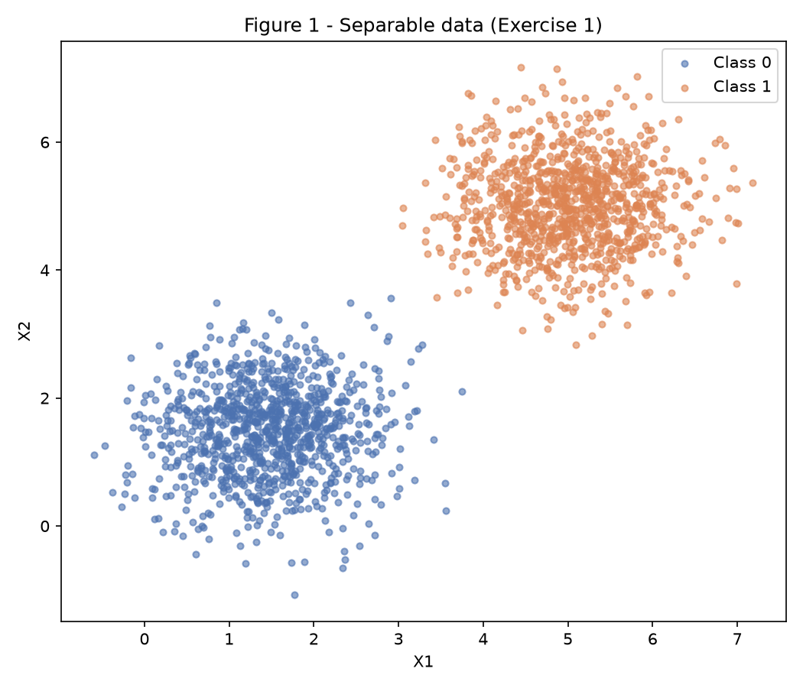
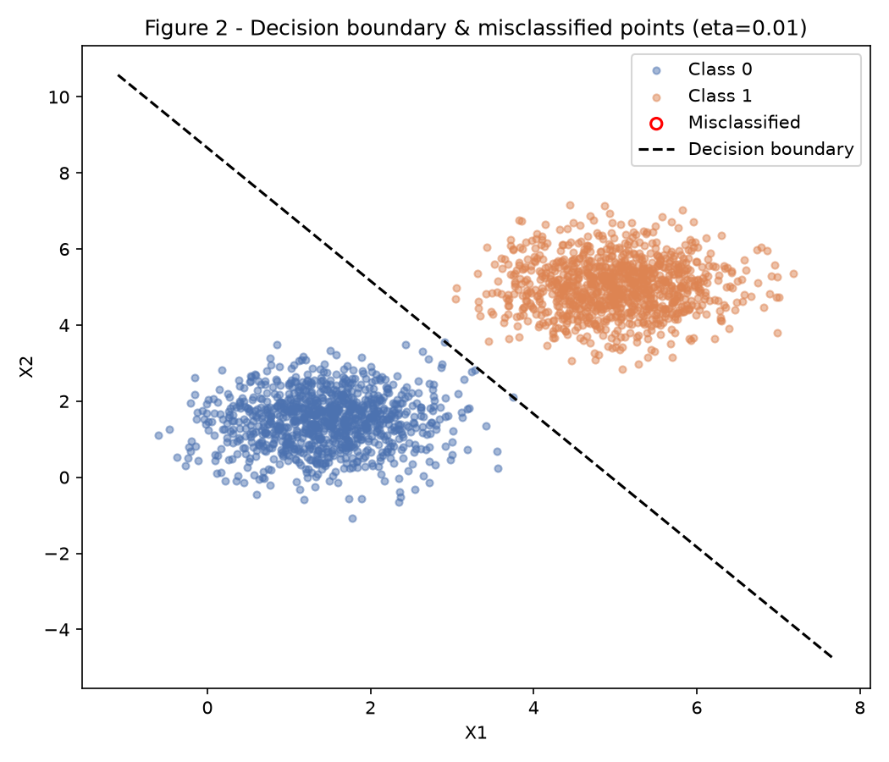
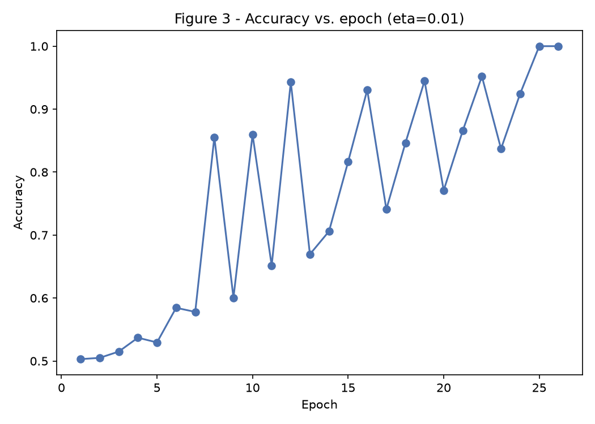
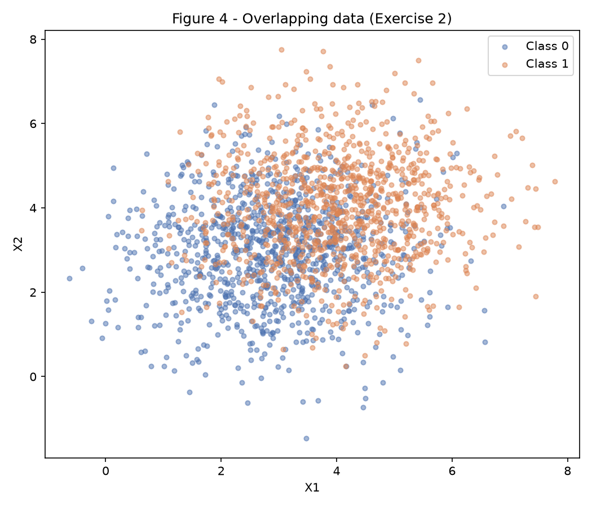
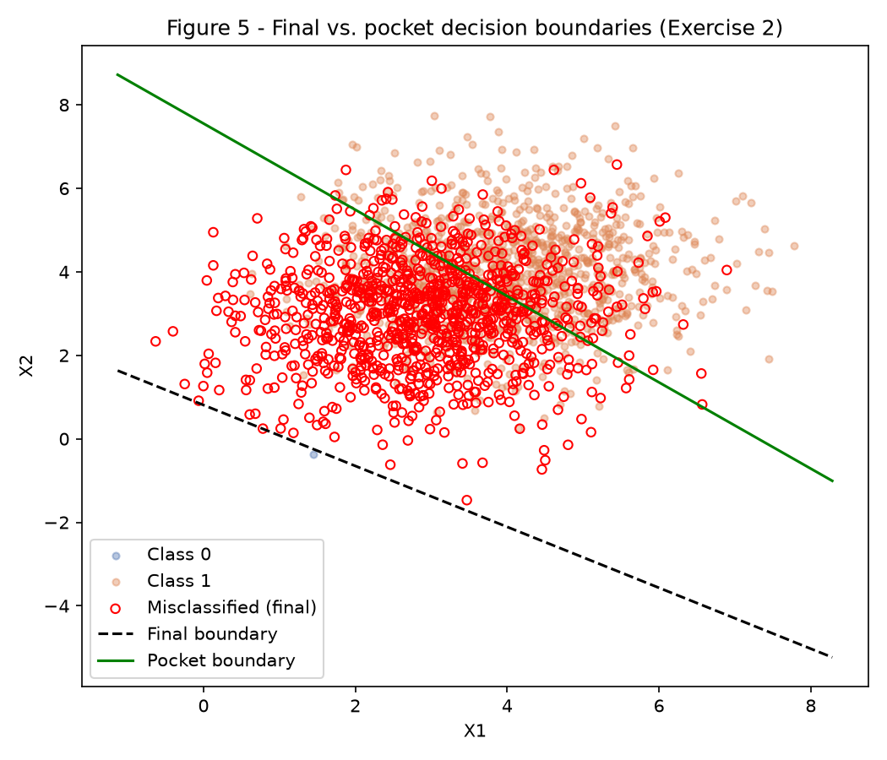
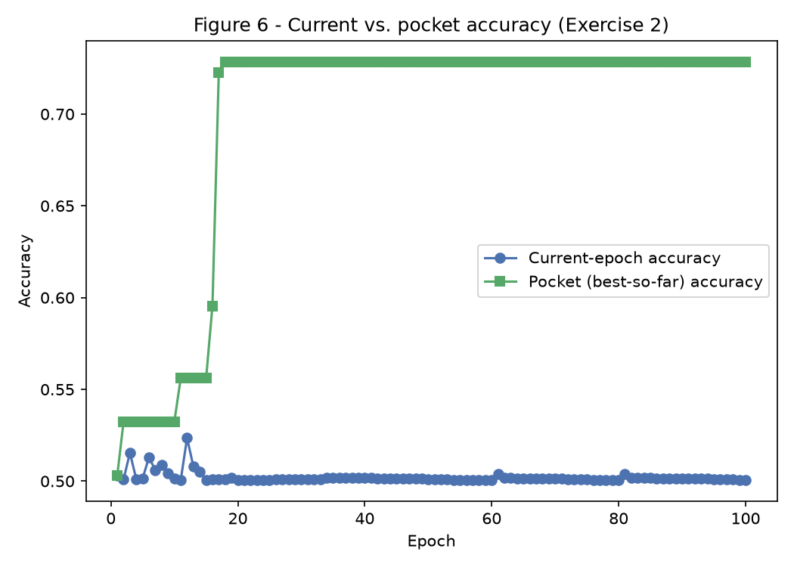

# Exercise 2 — Perceptron

The Perceptron (`code/perceptron.py`) is implemented once from scratch (numpy only) and reused, unmodified, by both exercises below. Everything is fixed with `rng = np.random.default_rng(42)` and reads/writes only inside this exercise's `code/` and `figures/` folders. Run any script from a clean checkout with:

``` shell
python3 -m venv env
source ./env/bin/activate
python3 -m pip install -r requirements.txt --upgrade
python3 docs/exercises/perceptron/code/ex1_separable.py
python3 docs/exercises/perceptron/code/ex2_overlapping.py
```

### Perceptron implementation

Prediction `ŷ = step(w·x + b)`, update `w ← w + η(y − ŷ)x` and `b ← b + η(y − ŷ)`, applied one sample at a time (online learning). Training stops either when a full epoch produces zero updates or after 100 epochs, whichever comes first. `fit(..., track_pocket=True)` additionally keeps the best weights seen so far (highest accuracy on the full dataset), checked after every single update — this is the Pocket Algorithm used in Exercise 2.

``` python
--8<-- "docs/exercises/perceptron/code/perceptron.py"
```

## Exercise 1 — Separable Data

### A — Data generation

1000 points per class from `Class 0: μ=[1.5,1.5], Σ=diag(0.5,0.5)` and `Class 1: μ=[5,5], Σ=diag(0.5,0.5)`.



### B — Perceptron

Weights initialized `w ~ N(0, 0.01²)` (size 2), `b = 0`, trained with `η = 0.01`.

``` python
--8<-- "docs/exercises/perceptron/code/ex1_separable.py"
```

### C — Training & measurement

| Quantity | Value |
|---|---|
| Final `w` | `[0.0505, 0.0289]` |
| Final `b` | `-0.2500` |
| Epochs to convergence | 26 (stopped early — full epoch with no updates) |
| Final accuracy | 1.0000 |





### D — Analysis

**1. Convergence speed vs. the update rule.** Each misclassified point pulls `w` and `b` a small step (`η=0.01`) toward correctly classifying it. Because the two classes sit `‖μ₁−μ₀‖=√(3.5²+3.5²)≈4.95` apart while each class has `σ=√0.5≈0.71` on every axis, the margin between the clouds is large relative to their spread, so a boundary that fixes one point rarely re-breaks another it had already fixed. Counting updates per epoch directly (`[3, 3, 4, 4, 3, 4, 3, 4, 2, 4, 2, 4, 2, 3, 3, 3, 2, 3, 3, 2, 3, 3, 2, 3, 1, 0]`) confirms the trend: it is noisy epoch-to-epoch (the boundary still sweeps back and forth while it rotates toward the gap) but trends down and hits exactly 0 at epoch 26, which is the convergence stopping condition. This is the qualitative content of the Perceptron Convergence Theorem: for linearly separable data the total number of updates over all of training is bounded by `(R/γ)²` (R = max point norm, γ = margin), so the update count is forced toward zero in finite time.

**2. Re-run with η = 1.0.**

| | η = 0.01 | η = 1.0 |
|---|---|---|
| Epochs | 26 | 37 |
| Final accuracy | 1.0000 | 1.0000 |
| `w` | `[0.0505, 0.0289]` | `[5.8706, 3.3592]` |
| `w / ‖w‖` | `[0.868, 0.496]` | `[0.868, 0.496]` |

Cosine similarity between the two `w/‖w‖` directions: **1.000000** — the learned decision boundary points in the same direction either way, only the magnitude of `w` (and the exact epoch count, since the boundary sweeps through a different sequence of intermediate positions at a bigger step size) differs. The direction is what actually encodes the boundary's orientation (`w·x+b=0` is invariant to scaling `w` and `b` by the same positive constant), so both runs converge to *the same line*, just reached via a coarser or finer walk.

**3. From `w=0, b=0`: algebraic proof that η only rescales.** Let `W_t, B_t` be the trajectory obtained by training with `η=1` from `W_0=0, B_0=0`, and let `w_t, b_t` be the trajectory obtained by training with any `η>0` from the same zero initialization, on the same data in the same order. Claim: `w_t = η·W_t` and `b_t = η·B_t` for every `t`.

*Base case:* `t=0`: `w_0 = 0 = η·0 = η·W_0`, and likewise for `b`.

*Inductive step:* assume `w_t = η·W_t`, `b_t = η·B_t`. The prediction at step `t` depends only on the **sign** of `w_t·x_t + b_t = η·(W_t·x_t + B_t)`. Since `η>0`, multiplying by `η` never flips a sign (and `η·0=0`), so `step(w_t·x_t+b_t) = step(W_t·x_t+B_t)` — both trajectories make the *same prediction* and hence trigger the *same* update decision `(y_t-ŷ_t)` at every step. Therefore:

`w_{t+1} = w_t + η(y_t-ŷ_t)x_t = η·W_t + η(y_t-ŷ_t)x_t = η·(W_t + (y_t-ŷ_t)x_t) = η·W_{t+1}`

and identically for `b_{t+1} = η·B_{t+1}`. By induction this holds for all `t`.

Consequently, two runs from zero initialization with learning rates `η₁` and `η₂` satisfy `w_t^{(η₁)} = η₁·W_t` and `w_t^{(η₂)} = η₂·W_t`, so `w_t^{(η₂)} = (η₂/η₁)·w_t^{(η₁)}` — the weights (and biases) differ **only** by the constant factor `η₂/η₁`, at every step, not just at convergence. This also means the *sequence* of predictions, misclassifications, and hence the epoch count, is **identical** regardless of η (since only the sign of `w_t·x_t+b_t` ever mattered): from `w=0,b=0`, η would be provably irrelevant to how many epochs training takes, only to the final magnitude of `w,b`. The actual run above used `w ~ N(0, 0.01²)` rather than exact zero, which breaks the *exact* proportionality (hence 26 vs. 37 epochs) — but since the initial `w` is tiny relative to the margin, the two trajectories still converge to essentially the same direction, which is exactly what the measured cosine similarity of 1.000000 shows.

## Exercise 2 — Overlapping Data

### A — Data generation

1000 points per class from `Class 0: μ=[3,3], Σ=diag(1.5,1.5)` and `Class 1: μ=[4,4], Σ=diag(1.5,1.5)` — means only 1 unit apart while each class has `σ=√1.5≈1.22` per axis, so the clouds overlap heavily.



### B — Training with the Pocket Algorithm

Same `Perceptron` class as Exercise 1 (`η = 0.01`, 100-epoch cap), called with `track_pocket=True`.

``` python
--8<-- "docs/exercises/perceptron/code/ex2_overlapping.py"
```

| Weights | `w` | `b` | Accuracy | Found at epoch |
|---|---|---|---|---|
| Final | `[0.0361, 0.0494]` | `-0.0400` | 0.5005 | — (epoch 100, cap reached) |
| Pocket | `[0.0068, 0.0066]` | `-0.0500` | **0.7285** | 18 |

Training never converges: `epochs_ran=100`, `converged=False`.

### C — Figures





### D — Analysis

**1. Gap between final (50.05%) and pocket (72.85%) accuracy.** Figure 5 shows exactly where the final boundary ends up: pushed to the *edge* of the data cloud, below almost every point, so it labels virtually the whole dataset as Class 1 — which happens to be correct for ~50% of points only because the two classes are equal-sized (1000/1000). The update rule only ever reacts to the *most recently seen* misclassified point, nudging the boundary toward fixing it — but with this much overlap there is no boundary that fixes everyone, so each correction for one point re-breaks others, and the boundary keeps drifting rather than settling near the best achievable line. The pocket weights, by contrast, are simply a *snapshot* of whichever point in that endless drift happened to score highest on the full dataset (epoch 18) — closer to the actual best linear separator (~73%) because it was chosen by evaluation rather than by wherever the walk ended up.

**2. Figure 3 vs. Figure 6 — the convergence theorem's assumption.** In Exercise 1 (Figure 3), the accuracy curve rises and then locks at 1.0 because the Perceptron Convergence Theorem guarantees that for **linearly separable** data, the (online, mistake-driven) Perceptron algorithm finds a fully separating hyperplane in a finite number of updates. Figure 6 never locks — current-epoch accuracy oscillates around 0.50 for the full 100 epochs — because that theorem's core assumption, **linear separability with a strictly positive margin γ>0**, is violated here: the two Gaussian clouds overlap, so no hyperplane classifies all 2000 points correctly, and the "zero updates in an epoch" stopping condition can never trigger. The pocket curve is the one exception that does stabilize, because it is a running max, not a live trajectory.

**3. Would more epochs or a smaller η fix it?** No, to both, and for the same underlying reason: the update rule only ever corrects one misclassified point at a time and has no mechanism to evaluate whether a proposed correction improves the *overall* dataset accuracy — it always takes the step regardless of net effect. More epochs just means more of the same non-convergent drift (the accuracy curve in Figure 6 is already stationary in distribution by epoch ~20; running longer does not trend it anywhere). A smaller `η` does not change *which* updates happen either — since the update decision `step(w·x+b)` only depends on the *sign* of the pre-activation, not its magnitude, shrinking `η` rescales the step size but leaves the sequence of misclassifications (and thus the endless drift) identical, only slower. The only thing that actually helps is precisely what the pocket variant does: decouple "keep training" from "keep the best weights seen," since with non-separable data the *best* solution and the *final* one are generally not the same point in weight space.

## Results summary

| # | Item | Value |
|---|---|---|
| 1 | Exercise 1 — final `w`, `b` | `[0.0505, 0.0289]`, `-0.2500` |
| 2 | Exercise 1 — epochs to convergence | 26 |
| 3 | Exercise 1 — final accuracy | 1.0000 |
| 4 | Exercise 1 — epochs & accuracy at η=1.0 | 37 epochs, 1.0000 accuracy |
| 5 | Exercise 2 — final `w`, `b` | `[0.0361, 0.0494]`, `-0.0400` |
| 6 | Exercise 2 — accuracy of final weights | 0.5005 |
| 7 | Exercise 2 — accuracy of pocket weights | 0.7285 |
| 8 | Exercise 2 — epoch when pocket best occurred | 18 |
