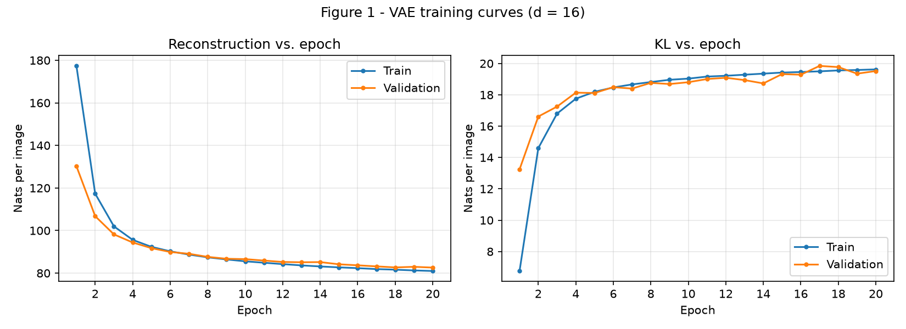
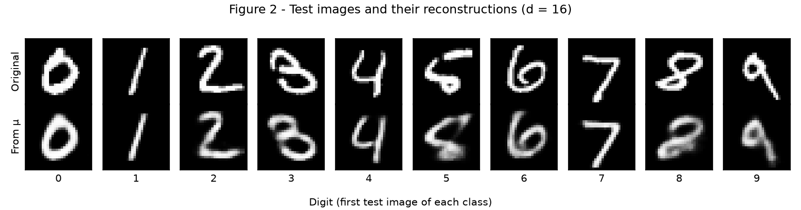
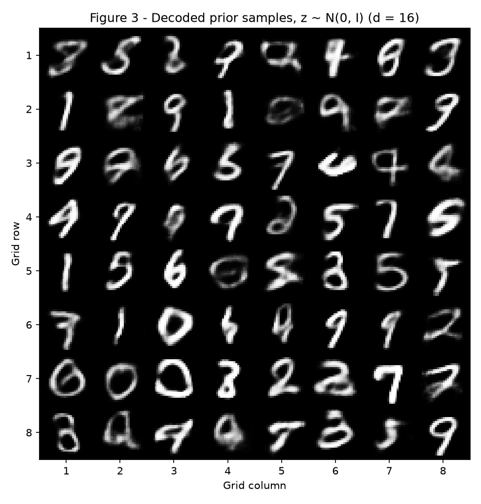
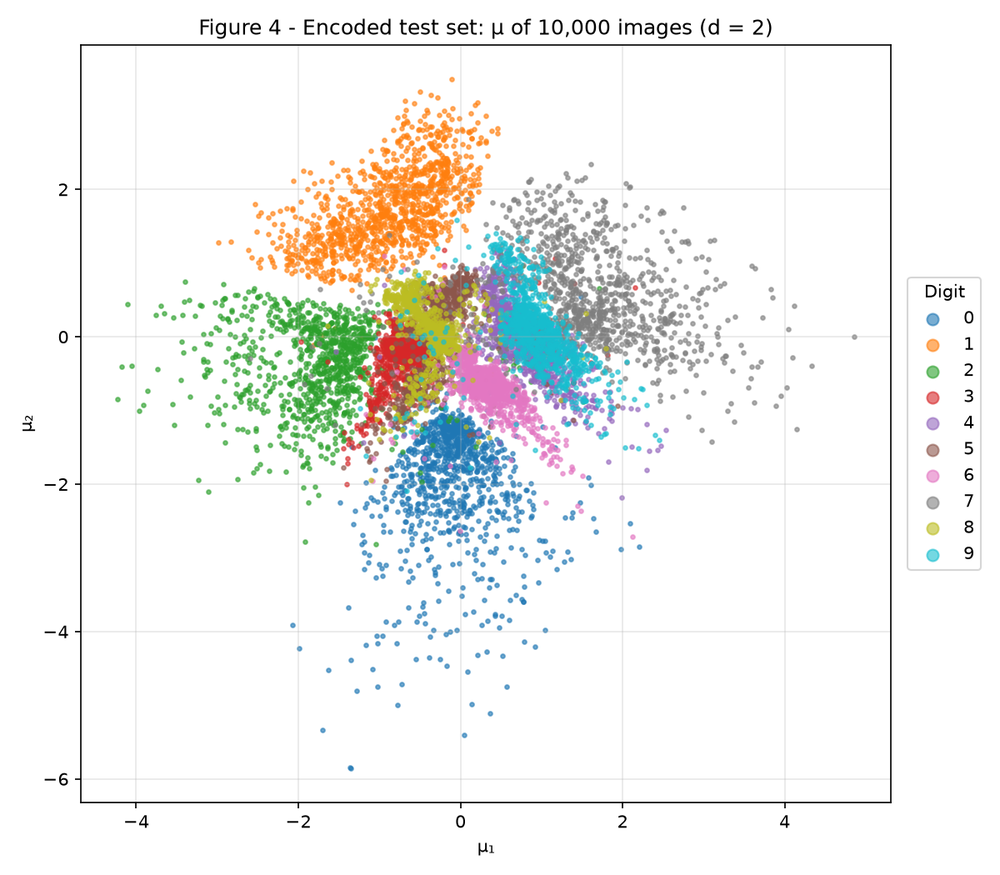
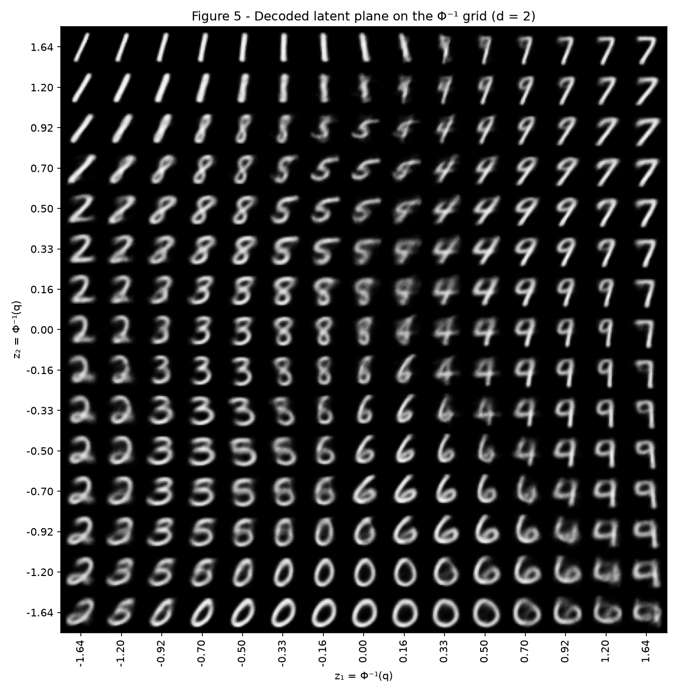
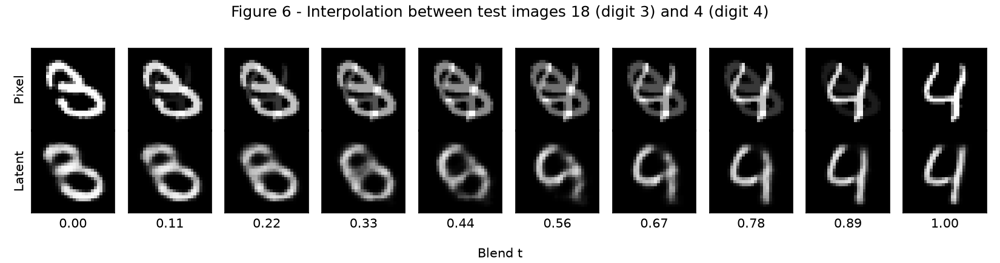

# Exercise 4 — VAE

`code/vae.py` holds everything both exercises share: the split, the model, the hand-written reparameterization and loss, and the training loop. Each model is built right after `torch.manual_seed(42)` and trained on CPU. Deleting the checkpoints and retraining reproduced every stored number exactly. Run from a clean checkout with:

``` shell
python3 -m venv env
source ./env/bin/activate
python3 -m pip install -r requirements.txt --upgrade
python3 docs/exercises/vae/code/ex1_mnist.py
python3 docs/exercises/vae/code/ex2_latent.py
```

The numbers quoted below are stored in `code/results/ex1.json` and `code/results/ex2.json`. All losses are in nats per image: summed over the 784 pixels (or the latent dimensions, for the KL) and averaged over images.

### Shared VAE implementation

``` python
--8<-- "docs/exercises/vae/code/vae.py"
```

## Exercise 1 — A VAE on MNIST

``` python
--8<-- "docs/exercises/vae/code/ex1_mnist.py"
```

### A — Data

MNIST comes from `torchvision`, with pixels divided by 255 to lie in [0, 1] and each image flattened to 784 values. `random_split` with `torch.Generator().manual_seed(42)` divides the 60,000 training images into **50,000 train and 10,000 validation**. The 10,000 official test images are the test set.

No training decision uses the test set: learning rate, batch size and the 20 epochs are fixed by the statement, and only validation is measured during training. The test set first appears after training, for the final numbers and the figures that require it.

### B — Model

- **Encoder:** 784 → 512 → 256, with ReLU after each layer, followed by two linear heads 256 → 16 for μ and log σ².
- **Decoder:** 16 → 256 → 512 → 784, with ReLU on the hidden layers and a sigmoid output.
- **Reparameterization:** z = μ + σ · ε, with ε ~ N(0, I). The randomness sits in ε, so gradients can flow through μ and σ.
- **Reconstruction:** `F.binary_cross_entropy(x_hat, x, reduction="sum")` divided by the batch size.
- **KL**, written out in closed form and summed over latent dimensions, then averaged over the batch:

\[
D_{KL}\big(q(z\mid x)\,\|\,N(0, I)\big) = -\frac{1}{2}\sum_{j=1}^{d}\left(1 + \log\sigma_j^2 - \mu_j^2 - \sigma_j^2\right)
\]

- **Loss:** reconstruction + β · KL, with β = 1.

As a check, I compared the closed-form KL with a hand-written Monte Carlo estimate on 200 test images, using 20,000 noise draws: **19.184 nats (closed form) against 19.183 nats (Monte Carlo)**.

### C — Training

Adam, learning rate 10⁻³, batch size 128, 20 epochs. Both terms are logged separately on train and validation at every epoch.

| Set | Reconstruction | KL | Negative ELBO |
|---|---|---|---|
| Train (epoch 20) | 81.00 | 19.62 | 100.63 |
| Validation (epoch 20) | 82.61 | 19.52 | 102.13 |
| **Test (final)** | **81.91** | **19.56** | **101.47** |

The test numbers match the references of about 81 and 20 nats.



**Figure 1.** At epoch 1, validation reconstruction (130.24) is far below train (177.36) and validation KL (13.24) is far above train (6.76). This is a measurement effect, not a sign that validation is easier: train values are averaged over the epoch, including the untrained first batches, while validation is measured after the epoch's updates. By epoch 20, validation reconstruction is 1.61 nats above train, so there is a small generalization gap.

### D — Reconstructions and samples



**Figure 2.** Most digits are recovered with the right identity and overall shape, but softer than the originals. The unusual shapes lose the most: the 5 and the 8 come back smeared.



**Figure 3.** The samples were decoded from 64 draws of z ~ N(0, I) after `torch.manual_seed(0)`. Many look like digits, for example the 1s, 7s, 9s and 0s, while others are smeared or mix two digits, such as row 2, column 2.

### E — Analysis

**1. Why does the KL rise in early epochs while the total loss falls?**

At the start, the decoder cannot use z, so the encoder has no reason to move away from the prior, and the KL is small. As soon as the decoder learns to use z, each nat of information the encoder puts into z removes more than one nat of reconstruction cost. The model therefore accepts a higher KL because the reconstruction gain is much larger.

From epoch 1 to epoch 2 on train, the KL rises by 7.84 nats (6.76 → 14.60) while reconstruction falls by 60.04 nats (177.36 → 117.33), so the total falls from 184.12 to 131.92. The exchange then slows: from epoch 10 to epoch 20, train KL only rises by 0.59 nats and reconstruction falls by 4.55 nats. Validation KL follows the same trend, from 13.24 at epoch 1 to 19.52 at epoch 20.

**2. Why does Figure 3 look worse than Figure 2?**

- **Where prior samples land.** Figure 2 decodes μ values of real images, so it uses regions the decoder was trained on. Figure 3 draws from the prior, which covers latent regions that no image is encoded to, and those z can fall between digit regions. Measured on the 11 active dimensions (KL above 0.5 nat), the median distance from a prior sample to its closest test μ is **1.71**, against **1.26** between neighboring test μ values. The other 5 dimensions are left out because the decoder barely uses them: including them gives 2.76 against 1.26, which overstates the gap. Decoded prior samples therefore often land off the digit regions, which gives the mixed shapes.
- **What the decoder outputs for a given z.** The decoder outputs one per-pixel Bernoulli mean for each z, not a sharp sampled image. When several different images are plausible for the same z, the BCE-optimal output is close to their average, and an average of different strokes is blurry. Gray pixels (between 0.1 and 0.9) measure this: **67.4 per image in the originals, 113.6 when decoding μ, and 133.1 when decoding prior samples** (10,000 samples). This blur exists in both figures, and it is stronger for prior samples because those z are more ambiguous.

**3. Why decode μ rather than a sampled z in Figure 2?**

μ is the center of the encoder's posterior for that image, so it is the model's best single answer and the figure is deterministic. A sampled z adds noise that only shows one random draw, which mixes the quality of the reconstruction with the luck of that draw. On the test set, decoding μ costs **76.71 nats**, against 81.91 nats with a sampled z.

## Exercise 2 — A Latent Space You Can See

``` python
--8<-- "docs/exercises/vae/code/ex2_latent.py"
```

### A — Train a 2-D VAE

Same model, data, seed, β and budget, with d = 2 only.

| Test set | Reconstruction | KL | Negative ELBO |
|---|---|---|---|
| d = 16 | 81.91 | 19.56 | 101.47 |
| **d = 2** | **134.05** | **6.77** | **140.82** |

These match the expected values of roughly 135 and 7 nats.

### B — Encoded test set



**Figure 4.** The μ of all 10,000 test images. Digits 1, 2, 0 and 7 reach out from the center into their own regions, while the others crowd together near the origin, and the overlaps there are the subject of 2.E.1. The points fill a blob roughly centered on the origin, which is what the KL term pushes toward, with a long tail for the 0s.

### C — Decoded plane



**Figure 5.** A 15×15 grid decoded at z = Φ⁻¹(q), with q taking 15 evenly spaced values in [0.05, 0.95], in the same orientation as Figure 4.

**Why this spacing gives every cell equal prior mass:** equal steps in q are equal steps of the prior's CDF, so each step along an axis holds the same probability (Δq = 0.0643), and because the two axes are independent, every cell holds the same product of those probabilities, 0.0643² = **0.00413**.

### D — Interpolation

The two images are **test index 18 (digit 3) and test index 4 (digit 4)**, the first test images of those digits. The latent row uses the d = 16 model from Exercise 1.



**Figure 6.** Ten values of t from 0 to 1. The top row blends pixels and the bottom row decodes the blend of the two μ vectors.

### E — Analysis

**1. Which digits overlap in Figure 4, and what happens in Figure 5?**

The clearest overlap is **4 and 9**. For each test image I took its 10 nearest neighbors in Figure 4 and averaged the share coming from the other digit: **31.4%** for 4 and 9, then **19.7%** for 5 and 8. The next pair, 3 and 5, is at 10.0%.

The same transition appears in Figure 5 around z₁ between 0.33 and 0.92, for z₂ between −0.5 and 0.5. Moving right along a row, a clear 4 with an open top gradually closes into a 9. The in-between images, for example near z₁ = 0.70 and z₂ = −0.33, have a top that is partly closed with a faint stroke, so they could be read as either digit. They are not separate blends of two digits but one shape that changes continuously, because 4 and 9 mostly differ by that one stroke.

**2. What must two numbers per image force the model to discard?**

Two numbers are enough to say which digit an image probably is, but little about how it was written, so **individual style is discarded**: stroke thickness, the exact slant, small loops and other details. Reconstruction is 52.13 nats worse than with d = 16 (134.05 against 81.91). The KL shows the same limit: d = 2 keeps about 6.77 nats per image (9.8 bits), against 19.56 nats (28.2 bits) for d = 16.

Figure 5 is the evidence. Each digit gets only a small patch of the plane, showing one smooth prototype with only slow changes, such as the slant of the 1s in the top-left corner. No patch shows the variety of real handwriting. Within a digit class, the per-pixel standard deviation of the images falls from **0.156** in the originals to **0.131** decoded with d = 16 and **0.086** decoded with d = 2, so d = 2 keeps clearly less of the within-digit variation.

**3. Which row of Figure 6 passes through digit-like images, and why?**

The **latent row** does. It goes from the 3 through shapes resembling an 8 and a 9 and ends at the 4, with every frame a single connected pen-like shape, although frames near t = 0.44 are ambiguous and all of them are blurry.

The **pixel row** does not. Each frame is a double exposure: both digits are visible at once, one fading out and the other fading in, and at middle values of t neither stroke is at full intensity. Digit images form a thin, curved set in pixel space, so the straight line between two of them leaves that set. In the latent space, the KL term keeps the encoded images in one connected region, and the decoder maps any point there to its best guess of a single image, so the straight line in z becomes a curved path through image space.

## Results summary

| # | Quantity | Value |
|---|---|---|
| 1 | Ex. 1: test reconstruction, KL, and negative ELBO (d = 16) | 81.91, 19.56 and 101.47 nats per image |
| 2 | Ex. 1: validation KL at first and last epoch | 13.24 (epoch 1) and 19.52 (epoch 20) nats per image |
| 3 | Ex. 2: test reconstruction and KL (d = 2) | 134.05 and 6.77 nats per image |
| 4 | Ex. 2: the two test indices interpolated | 18 (digit 3) and 4 (digit 4) |
